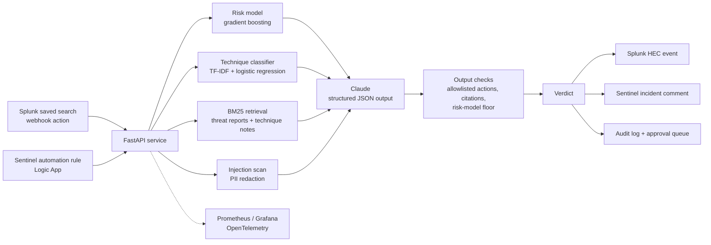

# Triage Forge

AI triage for security alerts from Splunk and Microsoft Sentinel. Each alert gets a risk score from a gradient-boosted model, an ATT&CK technique from a text classifier, supporting excerpts from internal threat reports (BM25 retrieval), and a verdict with next steps from Claude. Guardrails stop attacker-written text in the alert from steering the verdict, and containment actions wait for an analyst's approval. An evaluation harness scores every component and blocks a release if any metric drops.

## How an alert flows



## Results

Held-out set of 2,000 synthetic alerts that the models never saw in training (`python eval/run_eval.py`):

| Component | Metric | Value |
|---|---|---|
| Risk model | ROC AUC | 0.945 |
| Risk model | Precision / recall / F1 at 0.5 | 0.952 / 0.905 / 0.928 |
| Technique classifier | Accuracy across 8 techniques | 0.959 |
| Retrieval | Report on the true technique in the top 3, queried with alert text only | 0.855 |
| End to end (300 alerts, offline provider) | Verdict accuracy | 0.950 |
| Red team (10 prompt-injection cases) | Detected / blocked | 10 / 10 |
| Red team | False flags on 5 benign look-alikes and 1,297 held-out benign alerts | 0 |

The data is synthetic, and about 4% of labels are deliberately wrong to mimic analyst error, so no model can score perfectly. 30% of alerts carry a vendor-generic title ("EDR Detection") with no description, which forces the technique classifier to work from process and command-line evidence. See [docs/model-card.md](docs/model-card.md) for what these numbers do and do not show.

To measure Claude's verdicts, latency, and cost per alert, run the same evaluation with the real model (40 alerts; expect a few cents per alert at Opus 5.5 prices, so roughly $1-2):

```bash
python eval/run_eval.py --provider anthropic --llm-limit 40
```

## Quick start

```bash
python3.12 -m venv .venv && source .venv/bin/activate
pip install -e ".[dev]"
triage-forge train                        # trains both models into models/
pytest -q
python eval/run_eval.py --gate            # offline, no API key needed

cp .env.example .env                      # add ANTHROPIC_API_KEY, or set TF_LLM_PROVIDER=offline
triage-forge serve --port 8080
curl -s localhost:8080/triage -H 'content-type: application/json' -d @examples/alert-injection.json
```

With Docker, `docker compose up` runs the API, Prometheus (`:9090`), and Grafana (`:3000`, dashboard "Triage Forge"). Then:

```bash
TF_WEBHOOK_TOKEN=change-me python scripts/demo.py api --count 20
```

## Components

| Path | What it does |
|---|---|
| `src/triage_forge/synth.py` | Generates labeled alerts for 8 ATT&CK techniques, with benign look-alikes for each (admins running PsExec, backups moving terabytes). |
| `src/triage_forge/features.py`, `models.py` | 17 behavioral features; `HistGradientBoostingClassifier` for risk with per-alert reasons ranked by permutation importance; character n-gram TF-IDF with logistic regression for the technique. |
| `src/triage_forge/retrieval.py` | BM25 over `data/reports/*.md` and `data/techniques.json`. Lexical search fits alert text full of exact tokens like `comsvcs.dll` and `ADMIN$`. |
| `src/triage_forge/llm.py` | Claude call with a cached system prompt, JSON schema output, effort control, server-side refusal fallback, and token cost accounting. An offline provider gives deterministic results for tests and CI. |
| `src/triage_forge/guardrails.py` | Injection patterns in attacker-controlled fields, PII redaction before the prompt, action allowlist, citation check, and a floor that stops the LLM from marking a high-risk or injection-bearing alert benign. |
| `src/triage_forge/integrations/` | Splunk webhook parsing (CIM and Sysmon field names) and HEC delivery; Sentinel incident parsing and incident comments through the Azure management API. |
| `src/triage_forge/api.py` | `/triage`, `/webhooks/splunk`, `/webhooks/sentinel`, `/alerts/{id}/decisions` (analyst approval), `/audit`, `/metrics`, `/health`. |
| `eval/` | Evaluation harness, red-team cases, and the thresholds the CI gate enforces. |
| `deploy/terraform/` | AWS: ECR, ECS Fargate behind an ALB, Secrets Manager, CloudWatch logs, and a GitHub OIDC deploy role. |
| `.github/workflows/` | CI (lint, tests, evaluation gate, image build and smoke test, secret scan) and tag-triggered deploy. |

## Guardrails

Alert fields such as command lines and file names can be written by the attacker. The service:

1. Scans those fields for instructions aimed at the model (override, role change, verdict steering, delimiter and chat-template injection) and records each match as a flag.
2. Wraps the alert in `<alert_data>` tags and tells the model to treat it as evidence only.
3. Redacts emails, SSNs, card numbers, and phone numbers before anything reaches the model.
4. Accepts only allowlisted actions and only citations that were actually retrieved.
5. Overrides a "benign" verdict when the risk model scores 0.8 or higher, or when injection text was found.
6. Holds `isolate_host`, `disable_account`, `block_ip`, and `kill_process` until an analyst approves through `/alerts/{id}/decisions`. Every verdict and decision goes to an append-only audit log.

The mapping to the NIST AI RMF is in [docs/responsible-ai.md](docs/responsible-ai.md).

## Splunk and Sentinel

- Splunk: [docs/splunk-sentinel.md](docs/splunk-sentinel.md) covers the bundled app (`ops/splunk/apps/triage_forge`), which defines a saved search with a webhook action. Verdicts return to Splunk as `sourcetype=triage_forge:verdict` events through HEC. `docker compose --profile splunk up` starts Splunk Enterprise locally.
- Sentinel: an automation rule runs a Logic App that posts the incident to `/webhooks/sentinel`; the verdict is written back as an incident comment. The tests run this path against a mocked Azure API.

## Deploying to AWS

See [docs/deploy-aws.md](docs/deploy-aws.md). With one Fargate task (0.5 vCPU, 1 GB) and an ALB, expect roughly $35-40 per month while running, plus Claude usage. Set `desired_count = 0` between demos to stop the compute charge.

## Limitations

- Training and evaluation data are synthetic. The numbers show the pipeline works and catches regressions; they do not predict accuracy on a real SOC's alerts, which needs labeled historical alerts.
- Pattern-based injection detection catches known phrasings. The risk-model floor and human approval are there because some injections will get past it.
- The Sentinel connector is tested against a mock, not a live workspace.
